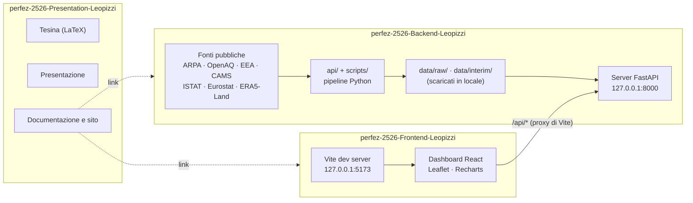

# OneHealth — Frontend

> Cruscotto di supporto decisionale per presidi medici e aziende sanitarie pubbliche e private, che affianca per zona e nel tempo **qualità dell'aria**, **calore urbano** e **salute** nel Salento (province di Lecce, Brindisi e Taranto, 20 distretti socio-sanitari e 145 comuni), usando solo **dati pubblici**: nessun hardware, nessuna rilevazione sul campo, nessuna interfaccia per il cittadino. La correlazione fra i domini è sempre **esplorativa, non causale**. Include ONE, un assistente che gira in locale (LLM open-source preaddestrato più RAG) e guida verso politiche di medicina di iniziativa.

## Il progetto in tre repository

| Repository | Contenuto |
|---|---|
| [perfez-2526-Presentation-Leopizzi](https://github.com/UniSalento-IDALab-corsoPerfez-25-26/perfez-2526-Presentation-Leopizzi) | tesina, presentazione, documentazione, ricerca |
| [perfez-2526-Backend-Leopizzi](https://github.com/UniSalento-IDALab-corsoPerfez-25-26/perfez-2526-Backend-Leopizzi) | client delle fonti, pipeline, API locale, assistente ONE |
| [perfez-2526-Frontend-Leopizzi](https://github.com/UniSalento-IDALab-corsoPerfez-25-26/perfez-2526-Frontend-Leopizzi) | dashboard e mockup ← sei qui |

## Architettura



## Come si collega agli altri repository

- **Backend**: espone `/api` su `127.0.0.1:8000`; lo schema è in `docs/openapi.json`. **Non contiene dati**: li scarica dalle fonti pubbliche.
- **Frontend**: `npm run dev` apre `127.0.0.1:5173` e gira ogni chiamata `/api/*` al Backend (variabile `ONEHEALTH_API_URL`). Il collegamento è **solo HTTP**: nessuno dei due importa file dell'altro; il contratto è lo schema OpenAPI.
- **Presentation**: documenta il progetto e rimanda agli altri due; nessun codice eseguibile.
- **Versioni**: Backend e Frontend vanno insieme alla stessa versione dell'API (oggi **0.2.0**, tag `v1.0.0` alla consegna).

Si consiglia di clonare i tre repository nella stessa cartella:

```text
OneHealth/
├── perfez-2526-Backend-Leopizzi/
├── perfez-2526-Frontend-Leopizzi/
└── perfez-2526-Presentation-Leopizzi/
```

## Struttura del repository

```text
src/                dashboard React + TypeScript (componenti/, stato/, api/, lib/, stili/)
public/             risorse statiche
strumenti/          tipi.mjs (rigenera i tipi dallo schema OpenAPI), cattura.mjs (schermate)
mockup/             mockup HTML di partenza
docs/               Specifiche_Design.md
.env.example        ONEHEALTH_API_URL e porta della dashboard
```

Stack: React, Vite, TypeScript, react-leaflet (tile OpenStreetMap, senza chiave), Recharts e react-query; tema a variabili CSS, chiaro e scuro, senza Tailwind.

## Avvio

La dashboard parla con il server del repository Backend: vanno avviati entrambi, in due terminali.

```powershell
# terminale 1 — Backend
cd OneHealth\perfez-2526-Backend-Leopizzi
uv sync
copy .env.example .env                                   # e inserire le chiavi
uv run --env-file .env scripts/backend/prepara_dati.py   # la prima volta: scarica i dati (v. README del Backend, sezione «Dati»)
uv run localhost/server/main.py                          # http://127.0.0.1:8000/docs

# terminale 2 — Frontend
cd OneHealth\perfez-2526-Frontend-Leopizzi
npm install                                              # solo la prima volta
npm run dev                                              # apre http://127.0.0.1:5173
```

All'avvio la dashboard chiama `/api/stato` e avvisa se il server non risponde, se è senza dati o se la sua versione dell'API è diversa da quella attesa. Con un Backend appena clonato (senza dati) l'avviso è «Server avviato, ma senza dati».

## Configurazione

| Variabile | Default | A cosa serve |
|---|---|---|
| `ONEHEALTH_API_URL` | `http://127.0.0.1:8000` | dove Vite gira le chiamate `/api/*` |
| `ONEHEALTH_DASHBOARD_PORT` | `5173` | porta della dashboard (se la cambi, aggiungi l'origine a `ONEHEALTH_ORIGINI` del Backend) |

Si impostano come variabili d'ambiente o in un file `.env` (copia di `.env.example`).

## Tipi dello schema OpenAPI

Il contratto con il Backend è il suo schema OpenAPI; `src/api/schema.d.ts` si rigenera così:

```powershell
npm run tipi                                                                    # dal server acceso
npm run tipi:file -- ..\perfez-2526-Backend-Leopizzi\docs\openapi.json          # a server spento, dal file del Backend
```

## Altri comandi

`npm run build` (controllo dei tipi e build), `npm run preview`, `node strumenti/cattura.mjs` (schermate senza browser integrato). Le specifiche di design sono in [`docs/Specifiche_Design.md`](docs/Specifiche_Design.md).

## Limiti dichiarati

- La correlazione fra aria, calore e salute è esplorativa: fumo, età, comorbidità e aria indoor sono confondenti che nessuna fonte pubblica misura.
- Dove non ci sono stazioni (124 comuni su 145, 8 distretti su 20) l'aria è solo **modellata** (Copernicus CAMS) e viene sempre dichiarata come tale.
- I **decessi** si mostrano solo a distretto × mese (privacy). Nessuna fonte pubblica dà cause di morte o ricoveri sotto la provincia.
- **Ricoveri, accessi in pronto soccorso e accessi ADI sono dati simulati**, calibrati su fonti pubbliche e sempre segnalati come «dato simulato, non reale».
- ARPA Puglia è letta dall'host `old.arpa.puglia.it`, non documentato dall'ente; la licenza CC BY 4.0 dei suoi dati è un'assunzione dichiarata.
- ONE non dà terapie, non nomina persone e arriva al comune, non al quartiere.

## Licenza e contesto

**Codice: Apache-2.0** (v. [`LICENSE`](LICENSE)). Mappa: © OpenStreetMap contributors (ODbL). Le attribuzioni dei dati sono nel repository Backend (`ATTRIBUZIONI.md`).

Progetto d'esame del Corso di Perfezionamento in Tecnologie Digitali per Ambienti e Sistemi Intelligenti, Università del Salento (IDA Lab), sviluppato con l'azienda partner Parsec 3,26 (Lecce). Autore: Matteo Leopizzi. Referente aziendale: Sergio Guglielmi. Referente accademico: prof. Luigi Patrono. Anno accademico 2025/2026.
